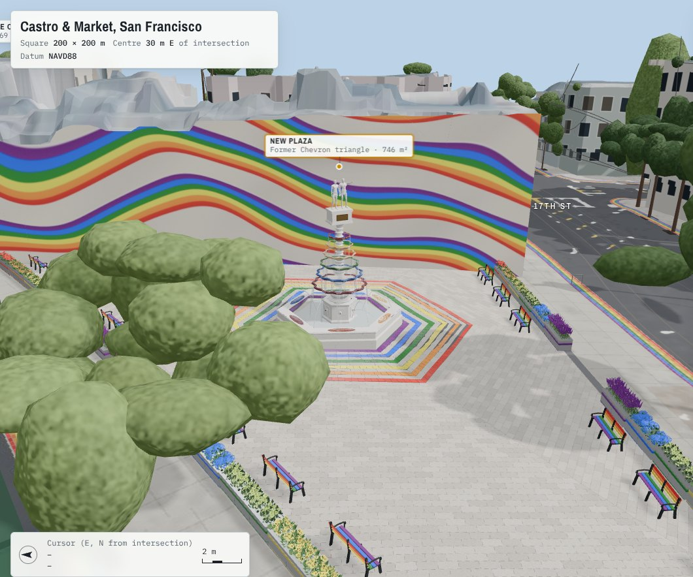
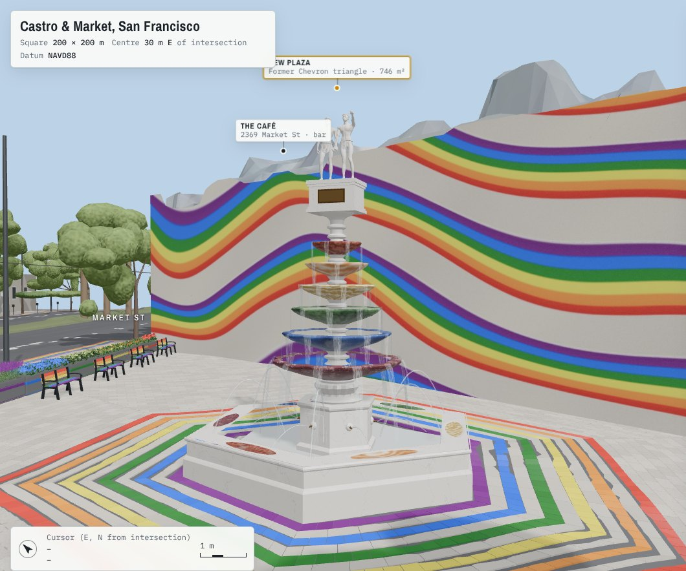
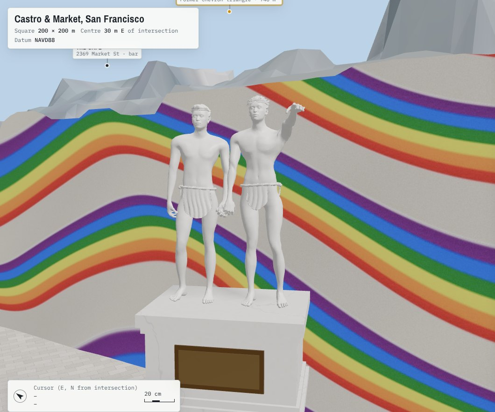
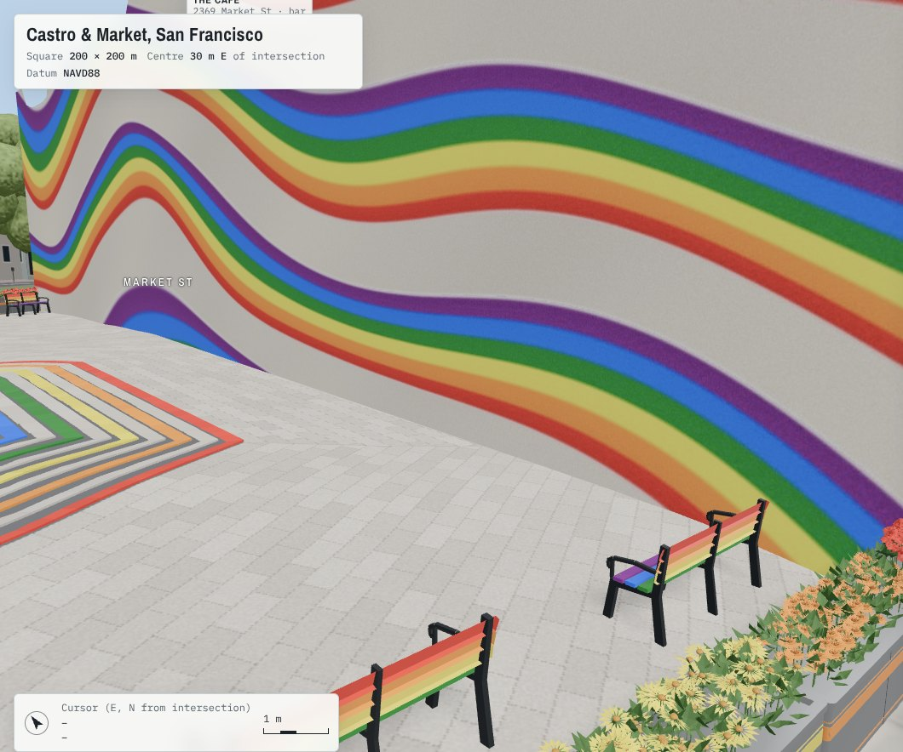
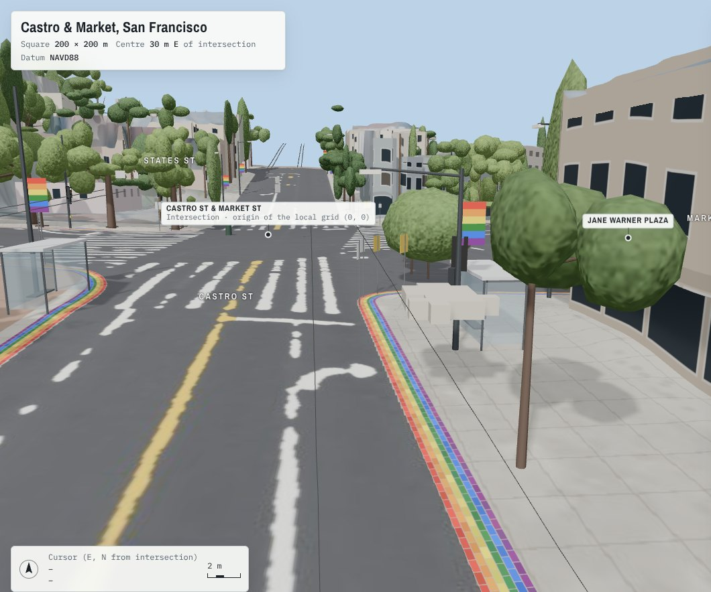
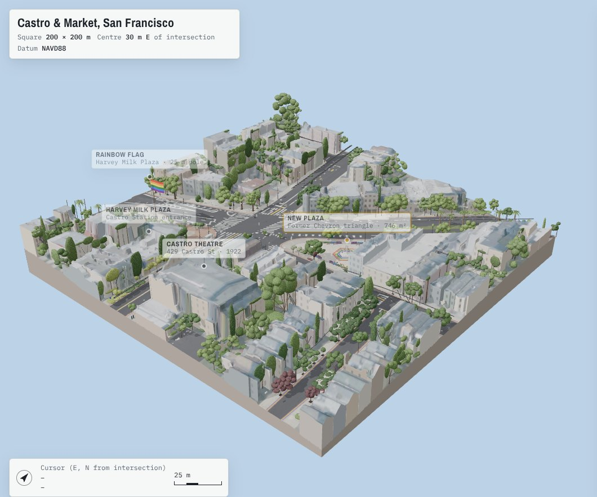
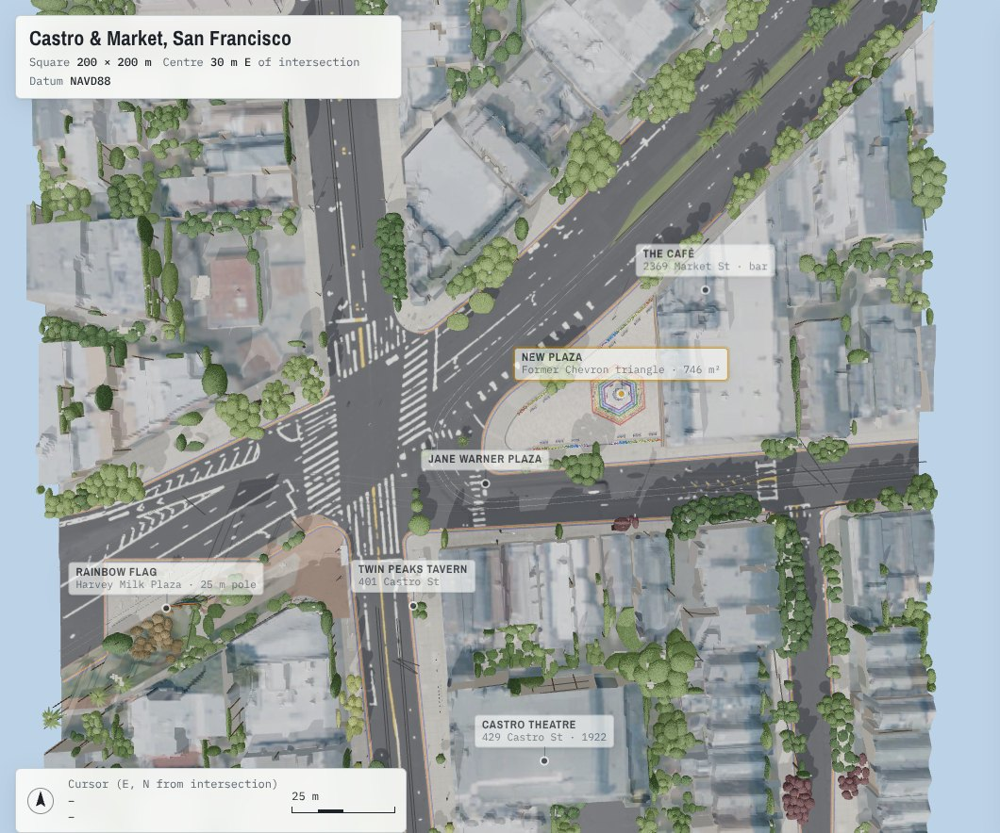

# Castro & Market — site model and plaza proposal

A 3D model of the 200 × 200 m square centred 30 m east of the intersection of Castro Street and Market Street in San Francisco, built from the 2023 USGS LiDAR scan and city open data. It also contains a design proposal: the Chevron station triangle at 2399 Market St turned into a public plaza with a rainbow fountain.



**Open the interactive viewer:** serve [`docs/`](docs/) with any static web server (for example `python3 -m http.server -d docs`), or open the GitHub Pages site if it is enabled for this repository. The viewer has preset views, layer toggles, a sun-position slider for San Francisco, east–west / north–south / height controls, and click-for-details on buildings, planters, benches and the fountain.

**3D files:** [`model/castro-market-model.glb`](model/castro-market-model.glb) (full precision, 40 MB) and [`model/castro-market-model-quantized.glb`](model/castro-market-model-quantized.glb) (24 MB, needs a glTF reader with `KHR_mesh_quantization`, e.g. Blender 2.9+). Units are metres, Y is up, and the origin is the centre of the square. Each building node carries its address, parcel, zoning and LiDAR heights in its `extras`.

## What is measured and what is proposed

**Measured (existing conditions):**

- **Terrain:** 25 cm ground model from the USGS 3DEP LiDAR scan `CA_SanFrancisco_1_B23` (2023, about 66 points/m²). About 37 m of relief across the square.
- **Buildings:** 78 DataSF footprints, roofs shaped from the LiDAR with overhanging tree canopy removed. Ground floors stand on the property line, and bay windows project up to 0.9 m above 3 m.
- **Streets:**
  - Curbs come from DataSF, with Castro St and 17th St corrected to the curb edges measured in the LiDAR.
  - Road markings are traced from the LiDAR intensity.
  - The F-line tracks come from OpenStreetMap.
- **Trees, poles and wires:** about 280 trees segmented from the point cloud, with species from the DataSF street-tree inventory. Poles, light arms and overhead wires are detected from point geometry.
- **Street furniture:** signals, signs, parking meters, bike racks, trash cans, bus shelters, a hydrant and a mailbox, from DataSF and OpenStreetMap.

**Proposed (design):**

- **Plaza:** the Chevron triangle rebuilt as a 746 m² plaza, its edge 5 m from the roadway, with square corners at the east wall.
- **Planters:** 24 stainless-steel boxes, 70 × 70 cm, in four stretches of six, planted in pride-flag order. Red sits at the corners and purple at the three openings.
- **Benches:** 14 with rainbow slats, parallel to the sides.
- **Paving:** hexagonal courses that radiate from the fountain, with six glazed rainbow tile rings alternating with plaza stone.
- **Fountain:** 6 m, white marble.
  - A hexagonal basin whose 56 cm rim is a seat with six coloured-stone insets.
  - Six cascading pools in natural stones: red jasper, orange alabaster, yellow calcite, verdite, sodalite and porphyry, red at the top.
  - Two 1.5 m marble figures holding hands on top, facing the Harvey Milk Plaza flag, for a total height of 7.5 m.
- **Mural:** an abstract flowing rainbow on the blank plaza-facing wall of 3970 17th St.
- **Brick rim:** a 90 cm band along the curbs of every street except Castro north of Market. It has six 15 cm brick courses in running bond, red at the curb and purple on the inside.
- **Overhead wires** are removed within 50 m of the centre (trams on battery there).

The pump layout of the old station (in `src/build_chevron.py`, no longer used), the window patterns and the vehicle shapes are stylised. Vehicles are detected but left out of the published model.

| | |
|---|---|
|  |  |
|  |  |
|  |  |

## Repository layout

| Path | Contents |
|---|---|
| `docs/` | The built viewer (static site): `index.html`, the packed model (`castro_model.txt`, a gzip+base64 GLB), textures, labels and camera presets |
| `model/` | The GLB files |
| `src/` | The Python pipeline (fetching, LiDAR processing, buildings, vegetation, streetscape, plaza, statues, assembly) |
| `web/` | Viewer source (`index.src.html`), labels and camera presets; the pipeline writes its generated assets here |
| `data/` | Source inputs that may be redistributed (see below) and a few small measured outputs (`curbfit.json`, `chev_areas.json`, `buildings_meta.json`) |
| `mh/` | MakeHuman base mesh, skeleton and macro targets (CC0), used for the statues |
| `tools/` | Headless render and Content-Security-Policy test helpers used during development |
| `images/` | Renders used in this README |

## Rebuilding

```bash
pip install -r requirements.txt
./build.sh
```

`build.sh` runs the pipeline in order. It downloads the sources, the LiDAR (about 40 MB of tiles, filtered to 5.6 M points) and the DataSF layers, then processes everything and writes `web/castro.glb`, `docs/` and `model/`. The last step needs Node.js for `gltfpack`. The scripts find the project root from their own location, or from `CASTRO_ROOT` if set.

The model was built interactively, step by step. `build.sh` records that order, and the one-off steps were saved as scripts (`fetch_sources.py`, `make_aerial.py`, `build_statues.py`, `build_viewer.py`), but the whole sequence has not been re-run from a clean checkout. Expect to fix small things on a first run.

Not included, and regenerated by the pipeline: the raw LiDAR tiles and about 400 MB of intermediate arrays. Also not included: Esri World Imagery tiles, which were used only as a visual reference during development and may not be redistributed (`src/esri.py` and the diagnostic plotting scripts that use them will not run without them).

## Sources and licences

| Source | Used for | Licence |
|---|---|---|
| USGS 3DEP LiDAR `CA_SanFrancisco_1_B23` (2023) and 3DEP 1 m DEM | Terrain, roofs, trees, poles, wires, curbs | Public domain |
| USGS NAIP imagery | Roof colours, aerial layer | Public domain |
| [DataSF](https://datasf.org) — building footprints, parcels, curbs, street trees, signs, meters, racks, trash cans, Muni stops and routes, curb ramps | Buildings, addresses, street furniture | ODC PDDL (public domain dedication) |
| [OpenStreetMap](https://www.openstreetmap.org/copyright) | Street centrelines, rails, plazas, places, flagpoles | © OpenStreetMap contributors, ODbL |
| [MakeHuman](https://github.com/makehumancommunity/makehuman) base mesh, rig and targets | Statue figures | CC0 |
| [three.js](https://threejs.org) (loaded from jsDelivr) | Viewer | MIT |

The data in this repository that comes from OpenStreetMap (`data/osm_raw.xml`) remains under the ODbL. The model and renders are produced works that use OpenStreetMap data.
